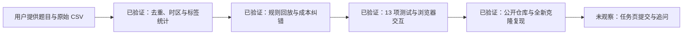

# AI 使用记录

本任务使用 Codex。本文由 AI 根据真实对话与工具结果整理，区分用户的要求与决策、AI 的分析与实现、工具实际验证的结果。日期：2026-10-22（北京时间）。

用户的主要作用是：提前安排环境准备，明确交付仓库与公开范围，主动调整工具使用路线，并提供要求 AI 独立判断、披露不确定性、展示工作状态和验证真实结果的全局工作标准。分析、编码和具体错误发现主要由 AI 执行。这里记录双方怎样协作，供后续追问核查。

## 用户设定的约束与验收标准

用户在本会话提供了全局 `AGENTS.md` 指令。以下是相关要求与本次交付证据的对应；中文为原要求的概括，不是补造的逐轮对话，也不表示用户逐项设计了实现细节。

| 用户提供的工作标准 | 本次交付中的对应做法与证据 | 责任边界 |
| --- | --- | --- |
| 质量、任务成功和验证优先；优先完成小而可验证的路径 | 交付可重跑分析、共享规则模块和可操作页面，运行方式见 [README](README.md) | 用户设定工作取向；原型范围及技术栈由 AI 选择 |
| 独立、严谨地协作；发现重要弱点要尽早指出 | AI 分工进行数据、代码和交付审查；保留二号车间反例，修正未知标签成本遗漏 | 分工方式、反例分析与错误发现由 AI 执行，不记成人工发现 |
| 先取证，再判断；区分事实、推断、不确定性和价值判断 | 区分原始行与唯一工单、已知与未知结果；把 50% 有效率写成假设，把回放写成探索性验证 | 用户要求证据标准；数据计算和具体口径由 AI 提出并复核 |
| 工作状态应可观察，标明已产出、已验证、受阻和未知；不得伪造遥测 | 交付时补记带证据的工作状态快照；下文提供公开摘要，未观察到的任务页提交仍单列 | 用户要求可观察性；快照是 AI 的关键节点记录，不是完整自动轨迹 |
| 完成意味着真实结果存在并经过验证，不能仅凭工具未报错 | 公开推送后从无凭据的新克隆重跑分析和 13 项测试，并核对原始数据与生成报告字节 | 验证由 AI 运行；不据此声称用户已人工复算或已在任务页提交 |

其中两条原文直接影响本记录的表述标准：

> “Distinguish verified facts, inference, uncertainty, and value judgments.”
>
> “Completion means the requested real-world outcome exists and has been reasonably verified; never infer success from a tool returning without errors alone.”

这些要求使交付可以被检查：读者可以重算数字、看到失败尝试和口径修正，并区分历史回放与尚未验证的现场效果。它们体现的是用户组织 AI 工作和设定验收标准的方式。

## 开始前准备

用户提示：“协助我完成这个任务”；“尚未开始，先准备环境”。AI 准备了 README/AI_LOG 模板及 CSV 结构检查脚本。该脚本用明确标记的合成输入测试过，但本次正式业务分析改用 `scripts/analyze.py`，准备测试不作为业务证据。

用户明确要求并确认创建 `AQI2022/guandeng-practical` 公开空仓库。GitHub 连接器没有创建仓库接口，安装官方 GitHub CLI。MSI 因管理员权限不足失败，改用当前用户目录的官方发布包。设备授权流程未能确认 CLI 凭据落盘；最终使用 Windows 已有的 AQI2022 凭据，仅在进程内调用 CLI，未写入仓库或输出凭据。仓库创建后核验为公开且为空。

这一步有用户实际介入：用户质疑通过网页手动创建的路线，提出“你没有github的mcp吗？我本地应也有github”，随后选择“安装 GitHub CLI 后创建”。工具能力检查、安装失败后的替代方案及命令执行由 AI 完成。这里的用户贡献是推动复用已有工具，并明确目标账号与仓库，而不是亲自编写 GitHub 调用。

公开推送曾因数据公开范围不明确被自动审批拦截。用户随后明确答复“允许，公开本题数据与成果”，授权公开题目 CSV、逐工单结果和历史样本；AI 在这一明确范围内完成推送。这是用户作出的发布决策，不是数据分析结论。

## 正式任务的关键输入

用户提供完整业务背景、字段说明、CSV 路径及提交规则。关键原文节选：

> “本次任务的目标是减少现场运维人员因系统协同异常导致的工单作业中断。”
>
> “每次工单执行中断约损失 90 分钟；每提前提示数据复核一次约花费 10 分钟。”
>
> “只用这份数据；自己补造的数据请在 README 里标明，不能作为结论依据。”

上述业务目标、成本和数据限制来自题目，由用户提供给 AI；不能将题目自带条件记为用户原创。用户未指定算法、阈值或原型设计。下述规则与取舍由 AI 提出并由实际数据回放核查。

## 分工提示与关键交互

本节记录主 AI 提出的执行方向及其对子代理的分工提示，体现具体执行过程；与上一节用户提供的全局工作要求分开记录。

主代理首先提出：“先检查时间同步、设备电量与失败的关系，再做一个能提前提示‘需复核’的最小工具，用 90 分钟中断成本和 10 分钟复核成本评估价值。”

给独立数据审查代理的提示（节选）：

> “重点：时区正确处理、重复 task_id/冲突/缺失、telemetry age 与失败、电量和温度混杂……只用发放数据，不能把关联当因果。”

后续提示（节选）：

> “以9/1–9/4开发、9/5–9/7时间回放。对比全场 age>15 和排除二号车间的规则……候选阈值5/10/15/20/30/45/60，成本 q=.5（假设）训练期选阈值。”

给页面实现代理的提示（节选）：

> “原生HTML/CSS/JS无依赖……不要使用task_status作为预测输入……显示‘历史样本演示，未连接设备’……正常只表示‘未触发时效复核，继续既有巡检流程’，不是安全保证。”

给代码测试代理的提示（节选）：

> “覆盖时区相同瞬间、边界15/15+、未来同步/缺失/无时区、无结果标签预测、二号scope、去重冲突与缺失结果统计……合成测试明确仅测试不作结论。”

## AI 哪里不对，如何修正

1. **最初倾向全场统一时效规则。** 独立复核发现二号车间在开发期的陈旧工单仅 1/28 失败，后期为 1/23。修正为用开发期成本准则选择试点车间，并把二号保留为影子观察。README 保留反例，不声称所有车间都受同一种协同故障影响。
2. **最初成本只算有结果的 81 次提示。** 这会遗漏另外 7 个未知结果工单的复核负担。独立 AI 审查代理指出后，主 AI 将测算改为 88 次都收取 10 分钟成本，不给未知标签任何收益信用；50% 情景从 1215 分钟改为 1145 分钟，盈亏平衡从 20% 改为 21.73%。精确率与召回率仍只使用已知结果，并披露未知标签边界。完整纠错过程见下节。
3. **时间分段容易被写成“独立测试集”。** 因为此前已做全量探索，审查明确指出不是严格盲测。文档改成“固定规则的探索性时间回放”，保留未来前瞻验证需求。
4. **15 分钟容易被误写成精确边界。** 审查发现 14–16 分钟根本没有样本。README 明示候选阈值的工程意义及这一证据缺口；代码测试边界仅验证实现，不提供该区间的业务证据。
5. **工具问题。** 一条 PowerShell 内联探索命令因引号失败，改用已有脚本；PowerShell 默认 JSON 解析不接受原始状态计数中的空字符串键，改为 `ConvertFrom-Json -AsHashtable`。这两次失败没有改变数据。没有通过忽略异常或把空值补零来让结果“通过”。

## 一个具体案例：用审查机制纠正 AI 的收益测算

这次修正的关键是将效果评估样本与实际复核工作量分别统计，避免漏算成本。

- **用户设定的标准：** 独立严谨、证据先行、暴露弱点、验证后交付。这是用户对 AI 工作方式的要求。
- **主 AI 的错误：** 将有结果标签的 81 次提示当成全部复核工作量，算出 `45 × 90 × 50% − 81 × 10 = 1215` 分钟。45 是回放中被提示的已知失败数，50% 是假设有效率。
- **独立 AI 审查的发现：** 另外 7 个未知结果工单也会触发提示。没有结果标签意味着不能确认收益，不意味着工程师不用花复核时间。
- **主 AI 的修改与复核：** 使用 `45 × 90 × 50% − (81 + 7) × 10 = 1145` 分钟；盈亏平衡为 `880 / (45 × 90) = 21.73%`。更新分析报告、README 和页面口径，独立计算核对提示总量与公式。

可复现入口是 [分析脚本](scripts/analyze.py)、[汇总报告](results/report.json) 和 [逐工单结果](results/task_decisions.csv)。读者可以分别核对“有无结果标签”和“是否触发提示”，再计算总复核成本。这个案例说明：评价 AI 方案不能只看一个漂亮的净收益数字，还需要检查分母、缺失数据和实施成本是否一致。它展示了用户所要求的审查标准在具体问题上的价值，错误发现和修正的执行归属仍是 AI。

报告同时保留已知标签样本的对照计算。主结论对应 `evaluation.net_minutes_q50_unknown_all_success`（1145）和 `evaluation.break_even_including_unknown_cost`（约 0.2173），不应误读成仅含已知标签的 `net_minutes_q50`（1215）。字段名中的 `unknown_all_success` 表示不给未知标签计入避免失败的收益，不表示实际已知这些工单成功。

## 工作状态的公开摘要

以下为交付时根据工具结果补记的关键节点，非完整自动遥测；不把“产出代码”“已运行验证”“已在任务页提交”混为一谈。

数据与回放证据见 [report.json](results/report.json)，测试和浏览器验收见 [VALIDATION.md](docs/VALIDATION.md)。该状态记录说明 AI 检查过什么、还不知道什么，不表示已经完成现场干预验证。

## 证据与验证方法

独立代码审查还发现 `task_id=null` 会被转换为字符串而通过校验。主代理修正为拒绝空值、布尔值和容器类型，并增加回归测试；同时让空 CSV 明确报错。修正后全部 13 项测试通过。

首次公开推送后，从未登录 GitHub 的全新克隆重新运行分析与测试均通过，数据哈希一致。发现 Windows 的默认换行导致 JSON 文件状态变化但计算内容无差异，随后固定 CSV/JSON 输出换行为 LF，并用 `.gitattributes` 保证原始 CSV 不被 Git 改写字节，再复核生成文件一致性。

- 原始 CSV 复制前后 SHA-256 一致；分析时使用有时区 datetime；去重后再分开发期与后期，避免重复工单跨段。
- 主分析脚本和独立分析分别复核：1242 原始行、59 重复、1183 唯一任务、56 未知结果、1127 已知结果、131 失败。
- 主分析输出与独立复核相符：后期 489 已知/27未知，81已知提示/7未知提示，45命中失败/36成功被提示/13漏报；主情景值1145分钟。
- 运行 `python -X utf8 scripts/analyze.py` 重建所有报告；运行 `python -X utf8 -m unittest discover -s tests -v` 检查边界、清洗与回放计数。
- 页面、API 和回放共用 `src/policy.py`。浏览器已实际核验：33 分钟样本触发提示、0 分钟不触发、二号 51 分钟样本说明未纳入试点、无时区输入提示异常；有效率滑块置 0% 后显示额外消耗 880 分钟。页面在当前窄视口可阅读，未验证真实手机或现场终端。

## 不应冒充已验证的内容

没有真实干预结果，也没有现场刷新或停机记录。没有证实网络/缓存故障根因，没有验证 50% 干预有效率，没有证明已经节省 19.08 小时。没有制造业务样本；合成测试仅用于程序边界。任务页的最终提交和后续追问需要用户完成，GitHub 推送成功本身不等于已在任务页提交。
